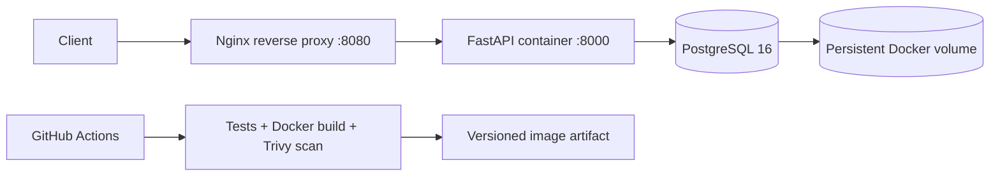

# Cloud Deployment & CI/CD – Bus Booking Platform
**Candidate:** Kratika Shukla | **Registration No.:** 12317004  
**Role:** DevOps & Cloud Engineering | **Organization:** ALGIONS AI LABS PRIVATE LIMITED

## 1. Overview
A small REST API for bus routes, trips, seat maps and passenger seat reservations. The assessment focus is reproducible containerization, CI, deployment, observability, backup/restore and recovery—not a full passenger-facing booking website.

## 2. Architecture

The API is attached to an internal backend network with PostgreSQL. Only the reverse proxy is exposed on the host. The API host binding is loopback-only for local administration. PostgreSQL has no published host port.

## 3. Stack
- Python 3.12, FastAPI, SQLAlchemy
- PostgreSQL 16, Docker, Docker Compose, Nginx
- GitHub Actions, pytest, Trivy
- OpenAPI docs: `/docs`

## 4. Run locally
Requirements: Docker Desktop / Docker Engine with Compose v2, Git.
```bash
git clone <your-repository-url>
cd bus-booking-devops
cp .env.example .env
# Edit .env and set a strong DB_PASSWORD
docker compose up --build -d
docker compose ps
curl http://localhost:8080/health/live
curl http://localhost:8080/health/ready
curl http://localhost:8080/trips
```
The first start creates schema and seeds two sample trips for tomorrow. Browse `http://localhost:8080/docs`.

## 5. Environment and ports
| Variable | Purpose | Example |
|---|---|---|
| `DB_PASSWORD` | PostgreSQL application password | Set privately in `.env` |
| `IMAGE_TAG` | Local image version tag | `local` |
| `DATABASE_URL` | Internal DB connection; set by Compose | `postgresql+psycopg://...` |

| Component | Container port | Host exposure |
|---|---:|---|
| Nginx | 80 | 8080 |
| API | 8000 | 127.0.0.1:8000 |
| PostgreSQL | 5432 | Not published |

Do not commit `.env`, credentials, certificates or real passenger data. In production, use a managed secret store and a dedicated least-privilege DB account.

## 6. API endpoints
- `GET /health/live`, `GET /health/ready`
- `GET /routes`, `GET /trips?travel_date=YYYY-MM-DD`
- `GET /trips/{trip_id}/seats`
- `POST /bookings`
- `GET /bookings/{pnr}`
- `POST /bookings/{pnr}/cancel`

Example booking:
```json
{
  "trip_id": 1,
  "seat_no": 1,
  "travel_date": "YYYY-MM-DD",
  "boarding_stop": "Delhi",
  "drop_stop": "Jaipur",
  "passenger": {"name": "Demo Passenger", "email": "demo@example.com"}
}
```
Use the actual date and stops returned by `GET /trips`. A confirmed seat is protected by a database-level partial unique index on `(trip_id, seat_no)` where status is `CONFIRMED`; conflicting concurrent requests receive HTTP 409. Cancelling changes status and releases the seat for a later booking. PNRs are generated server-side.

## 7. CI/CD
`.github/workflows/ci.yml` runs on pushes and pull requests to `main`/`master`: Python compile check, pytest, Docker image build tagged with the commit SHA, and Trivy scan. The workflow does not deploy automatically; this avoids deploying unreviewed code. After CI passes, deploy the exact tested commit:
```bash
git rev-parse HEAD
IMAGE_TAG=$(git rev-parse --short HEAD) docker compose build api
IMAGE_TAG=$(git rev-parse --short HEAD) docker compose up -d
```
For a registry-based release, authenticate using GitHub Actions secrets and push `ghcr.io/<owner>/bus-booking-api:<commit-sha>`. Do not put tokens in workflow files.

## 8. Observability and failure recovery
```bash
docker compose ps
docker compose logs --tail=100 api
docker compose logs -f proxy
curl -i http://localhost:8080/health/ready
```
Failure drill:
```bash
docker compose stop api
curl -i http://localhost:8080/health/ready   # expect proxy/upstream failure
docker compose start api
docker compose ps                            # wait until healthy
curl http://localhost:8080/health/ready
```
Logs are structured key-value style with timestamps and event names (`booking_created`, `booking_cancelled`, `Seat conflict`). Liveness checks process availability; readiness checks database connectivity.

## 9. Backup, restore and rollback
Create a PostgreSQL custom-format backup:
```bash
chmod +x scripts/*.sh
./scripts/backup.sh
ls -lh backups/
```
Restore a selected backup (destructive to current DB contents):
```bash
./scripts/restore.sh backups/<backup-file>.dump
```
After restore, verify readiness, trips and bookings. For a release rollback, redeploy the previously recorded immutable image tag/commit:
```bash
IMAGE_TAG=<previous-known-good-tag> docker compose up -d --no-build
docker compose ps
curl http://localhost:8080/health/ready
```
Keep backups outside the application host for real production use; test restore periodically.

## 10. Security controls and limitations
- API container runs as a non-root user.
- PostgreSQL is not exposed to the host; backend network is internal.
- API host port is bound to loopback; Nginx is the public entry point.
- Secrets are supplied via `.env` locally and excluded from Git.
- Trivy scan is included in CI; its current policy reports findings but does not fail the pipeline (`exit-code: 0`).
- TLS configuration template is in `deploy/nginx-https.conf`. For HTTPS, mount a valid certificate/key and enable port 443; do not use self-signed TLS as production evidence.
- Demo scope only: no payment gateway, authentication/authorization, seat-hold expiry, distributed rate limiting or external monitoring stack. Add authentication and stronger PII controls before any real deployment.

## 11. Test and evidence checklist
Run:
```bash
python -m venv .venv
# Windows: .venv\Scripts\activate
# macOS/Linux: source .venv/bin/activate
pip install -r requirements.txt
pytest -q
```
Capture genuine screenshots of:
1. GitHub Actions green CI run and commit SHA.
2. `docker compose ps` with healthy services.
3. `/health/ready` response and API logs.
4. Duplicate booking test returning 409.
5. Backup file listing and successful restore output.
6. Stop/start failure drill and recovered readiness.

**Do not claim screenshots, a public URL, HTTPS, cloud deployment, registry push or a green workflow unless you have actually performed and verified it.** The provided deployment is a local Docker Compose demonstration. Add your repository URL, final commit SHA, pipeline run URL and demo video link to the submission form after creating them.

## 12. Operations runbook
| Operation | Command |
|---|---|
| Deploy/update | `docker compose up --build -d` |
| Restart API | `docker compose restart api` |
| Status | `docker compose ps` |
| API logs | `docker compose logs -f api` |
| Backup | `./scripts/backup.sh` |
| Restore | `./scripts/restore.sh backups/<file>.dump` |
| Rollback | `IMAGE_TAG=<old-tag> docker compose up -d --no-build` |

Incident response: check readiness → inspect API/DB/proxy logs → identify the failing component → restart only the affected service → verify readiness and API behaviour → restore last known-good backup or image if data/release corruption is confirmed → document timeline and root cause.

## 13. AI and attribution
AI assistance may be used for scaffolding and documentation. Candidate must review, run, test and be able to explain all code. Dependencies are listed in `requirements.txt`; sample trip data is synthetic and generated by `app/seed.py`. Disclose the actual AI tools used and the extent of assistance in the assessment form.
