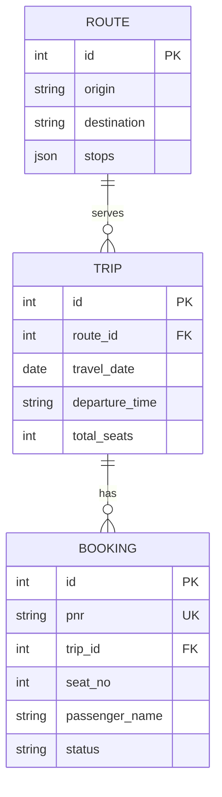

# Architecture and data model

A partial unique database index guarantees at most one `CONFIRMED` booking per `(trip_id, seat_no)`. The invariant is enforced in the database, not only by an application-side availability check, so concurrent requests cannot both confirm the same seat.
